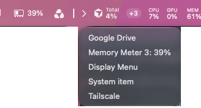
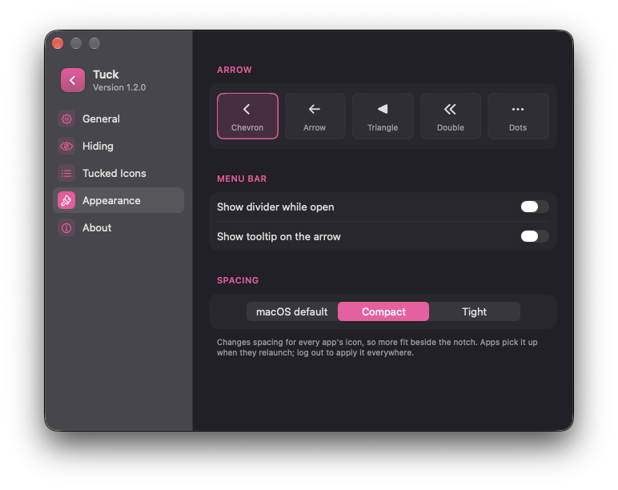

# Tuck for macOS

Tuck the menu bar icons you rarely need behind a divider. Click the arrow, press a shortcut, or let it fold itself away again. The macOS sibling of [Tuck for Omarchy](https://github.com/twodxme/omarchy-tuck).

**Tucked away:** one arrow, and a count of what's behind it.


**Open:** the tucked icons slide out left of the divider ( | ).


**⌥-click:** icons in the always-hidden section, left of the dashed divider, show too.


Tiny and asleep almost all the time: 0% CPU and no wakeups while tucked away, about 20 MB of memory, a 0.3 MB app. Works on macOS 13 and later, tested on macOS 27.

## Install

With [Homebrew](https://brew.sh):

```bash
brew tap twodxme/tap
brew trust twodxme/tap      # newer Homebrew asks you to trust third-party taps
brew install --cask tuck
```

Or download `Tuck.zip` from the [latest release](https://github.com/twodxme/macos-tuck/releases/latest), unzip it, and move Tuck.app to /Applications.

Tuck isn't notarized (that needs a paid Apple developer account), so macOS blocks its first launch. Open it once, then go to **System Settings → Privacy & Security** and click **Open Anyway**.

Or build it yourself; only the Command Line Tools are needed, no Xcode:

```bash
scripts/build-app.sh        # -> build/Tuck.app, universal, ad-hoc signed
cp -R build/Tuck.app /Applications/
```

## Use

1. Hold **⌘** and drag the menu bar icons you want out of the way to the **left of Tuck's divider** ( | ). Drag them right of the arrow to bring them back.
2. **Click** the arrow to show or hide them, or press **⌥⌘\\** from anywhere.
3. **Hold** the shortcut to peek: the icons tuck away again when you let go.
4. **Right-click** (or ⌃-click) the arrow for Tuck's menu.

### The menu

Right-click the arrow and Tuck's menu slides down out of the menu bar like a drawer: show or tuck away with one click, flip the everyday options, open a tucked icon, or get to Settings, help, and Quit. Escape, a click elsewhere, or another click on the arrow closes it.


Tuck folds itself away after a few seconds, or as soon as you switch to another app, but never under the pointer or while a menu is open.

### Always-hidden section

Turn on **Settings → Always hidden** and a second, dashed divider appears. Icons left of it stay hidden even while Tuck is open: the place for icons you need once a month. **⌥-click** the arrow (or `open tuck://all`) to show them too.

### Tracking tucked icons

Turn on **Settings → Count and list tucked icons** (it asks for Accessibility; see [Permissions](#permissions)) and Tuck can:

- show **how many icons are tucked**, next to the arrow
- list them in Settings with an **Untuck** button each, which moves the icon right of the arrow for you
- list them in the menu too, with app icons: click one to open it
- **quick open**: a shortcut that lists tucked icons under the arrow. Type a few letters, press Return, and that icon's menu opens without untucking anything.



### Links

For scripts, Raycast, Shortcuts, or a keyboard tool:

```bash
open tuck://toggle      # show or hide
open tuck://expand      # show
open tuck://collapse    # hide
open tuck://all         # show the always-hidden section too, or back
open tuck://quickopen   # the quick open menu
open tuck://menu        # Tuck's menu
open tuck://settings
```

## Settings

Settings has five sections in a sidebar: General, Hiding, Tucked Icons, Appearance, and About. Hiding sketches how the menu bar is split up, so the divider trick explains itself.

<p>
  
  
</p>

| Setting | Default | |
|---|---|---|
| **Open on** | Click | *Hover* opens when the pointer reaches the arrow and closes once it leaves the menu bar. |
| **Tuck away automatically** | on, 10 s | 1–300 seconds. Waits while the pointer is in the menu bar or a menu is open. |
| **Tuck away when I switch apps** | on | |
| **Open while ⌘-dragging menu bar icons** | off | Opens as you start rearranging, so icons can be dropped into the tucked area. |
| **Start open** | off | |
| **Shortcut** | ⌥⌘\\ | Also ⌃⌥⌘T, ⇧⌘\\, ⌃⌥\\, ⌥⌘/, ⌃⌥⌘O, or none. Tap to toggle, hold to peek. |
| **Launch at login** | off | Tuck must be in /Applications. |
| **Always-hidden section** | off | |
| **Count and list tucked icons** | off | Needs Accessibility. |
| **Show count on the arrow** | on | |
| **Quick open shortcut** | none | Same choices as the main shortcut; ignored if they clash. |
| **Arrow** | Chevron | Arrow, Triangle, Double chevron, Dots. |
| **Show divider while open** | on | |
| **Show tooltip on the arrow** | on | |
| **Menu bar icon spacing** | macOS default | *Compact* or *Tight* fit more icons beside the notch. Changes every app's spacing; apps pick it up when they relaunch, all of them after you log out. |

Settings live in `com.twodxme.tuck` defaults, so `defaults write com.twodxme.tuck autoHideSeconds -int 30` works too (restart Tuck after). Values Tuck doesn't understand fall back to the default.

One expert key has no UI. If icons stay visible on some display, set the collapsed divider width by hand (100–5000 points; delete the key to go back to automatic):

```bash
defaults write com.twodxme.tuck collapsedLength -float 900
```

## Permissions

**None by default.** The shortcut uses Carbon hot keys and ⌘-drag detection uses a mouse-press monitor; neither needs a permission.

**Accessibility**, only if you turn on *Count and list tucked icons*: macOS has no other way to see other apps' menu bar icons or move them. Tuck is ad-hoc signed, so macOS treats every new version as a new app. After an update, remove Tuck from **Privacy & Security → Accessibility** with **−** and switch the setting off and on again so it asks afresh (or run `tccutil reset Accessibility com.twodxme.tuck`).

## Resource use

Tuck is built to disappear:

- **Nothing polls while tucked.** Timers exist only while Tuck is open (auto-hide, hover) and carry tolerance, so macOS can batch them with its own wakeups.
- **Listeners are event-driven and scoped.** The app-switch observer exists only while open, the ⌘-drag monitor only while tucked and only if you turned it on.
- **Accessibility scans run only while open**, in the background, asking apps in parallel with a short timeout so a frozen app can't stall them (~0.3 s).
- **Small build**: optimized for size and stripped; the universal binary is about 0.3 MB.

The short fade as icons tuck and untuck is drawn by macOS, not Tuck. Tuck's own work takes about 8 ms; the rest (roughly a fifth of a second before macOS redraws, then its fade) happens in the system menu bar process and can't be shortened by an app.

## How it works

macOS gives apps no way to hide another app's menu bar icon. Tuck adds a divider and an arrow, and while tucked stretches the divider so everything left of it is pushed off screen: the approach of Hidden Bar, Dozer, and Ice. The always-hidden section is a second divider that stays stretched while Tuck is open.

Recent macOS drops a menu bar item wider than about half the screen, so the divider is sized to just past the space right of the notch (or just under half the screen without one) instead of a fixed huge width, and resized when displays change. Tuck refuses to collapse if the divider ends up right of its arrow (that would push the arrow away too) and says so in the arrow's tooltip.

A few macOS 27 details Tuck works around: clicks on menu bar icons arrive without their modifier keys (so ⌥-click reads the keyboard directly), freshly created icons report no position for about 0.3 s (so launch waits for real ones), and scroll events never reach menu bar icons.

## Develop

```bash
swift build
scripts/test.sh                 # swift-testing, works with only the CLT installed
/usr/bin/log stream --level info --predicate 'subsystem == "com.twodxme.tuck"'
```

The log shows every state change (`mode open`, `mode collapsed`, `mode all`) and why a collapse was refused.

Push a `v*` tag and GitHub Actions tests, builds, and publishes a release with `Tuck.zip` and its SHA-256. Then bump `version` and `sha256` in the [tap's cask](https://github.com/twodxme/homebrew-tap/blob/main/Casks/tuck.rb).

## License

MIT
